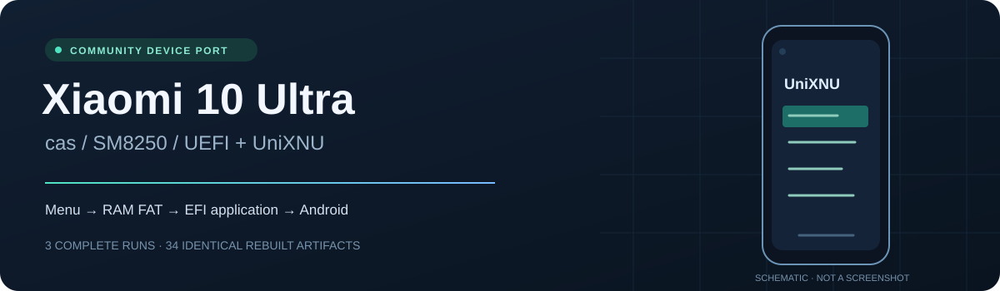

<p align="center"></p>

<p align="center"><strong>English</strong> · <a href="README.zh-CN.md">简体中文</a></p>
<p align="center"><a href="docs/build.md">Build</a> · <a href="docs/operations.md">Boot & controls</a> · <a href="docs/validation.md">Validation</a> · <a href="https://github.com/ht94911/UniXNU-cas/releases">Releases</a> · <a href="docs/architecture.md">Architecture & next steps</a></p>

# UniXNU for Xiaomi 10 Ultra

A community port for **Xiaomi 10 Ultra / Mi 10 Ultra (`cas`, M2007J1SC, SM8250)**. This is the project home for device configuration, checked build tools, documentation and future device-specific operating-system work. The companion [uefi-cas](https://github.com/ht94911/uefi-cas) repository contains the Mu-Silicium firmware port.

**Current milestone:** UEFI and the real UniXNU menu run on the tested phone. Physical buttons work; a test EFI application loads from read-only RAM FAT, executes and returns to the menu; the phone reboots to its existing Android installation. The same candidate passed **three independent complete runs** and a **byte-identical rebuild of 34 artifacts**.

DarwinBoot handoff, XNU and iOS have **not been tested**. This release is an early hardware bring-up milestone.

## What works

| Capability | Recorded result |
| --- | --- |
| Temporary USB Fastboot boot | Verified on the tested cas / firmware combination |
| Display | ABL framebuffer preserved; 1080 × 2340 output |
| Physical controls | Volume navigation; short power press to confirm |
| UniXNU boot manager | Four-item menu, navigation and error return |
| Read-only RAM FAT | 16 MiB volume with configuration and CasSmoke EFI |
| EFI execution and return | `cas-smoke-001` marker, return to a usable menu |
| Missing EFI file | `Not Found` in the menu's bottom status line |
| Exit to Android | UniXNU menu or firmware menu; Android boot completion checked |
| Repeatability | Three independent runs of one unchanged boot image |
| Rebuild | 34 outputs compared byte for byte in the recorded toolchain |

Touch, GPU acceleration, internal UFS filesystems, USB keyboard, charging management and ADB inside UEFI are outside this milestone. Other phones, memory variants and firmware combinations have not been validated. See [the full validation record and evidence limits](docs/validation.md).

## Start here

| Goal | Read |
| --- | --- |
| Understand the result and its limits | [Validation](docs/validation.md) |
| Build the frozen candidate | [Build and reproducibility guide](docs/build.md) |
| Use the menus or return to Android | [Boot, controls and recovery](docs/operations.md) |
| Review the firmware implementation | [uefi-cas](https://github.com/ht94911/uefi-cas) |
| Continue the port toward XNU / userspace | [Architecture and future work](docs/architecture.md) |
| Report a problem or contribute | [Contributing](CONTRIBUTING.md) |

The [release](https://github.com/ht94911/UniXNU-cas/releases/tag/v0.1.0) provides source bundles, source-built EFI/FD/FAT/shim components, licenses, environment pins and a sanitized evidence summary. The full `boot.img` depends on a matching private stock DTB and is kept locally. It is **not included in the public download**. The build guide explains the required inputs.

## Frozen milestone

Candidate: **`cas-complete-001`** · boot image: **17,616,896 bytes**

```text
a085d19b6a4a1ea429f2f10cb191050f316cf044d4fd864b53d398e4f6a4f67c
```

| Source | Hardware-tested commit |
| --- | --- |
| [Device configuration and tools](https://github.com/ht94911/UniXNU-cas/tree/cas-complete-001) | `346a404f6cee464e3e95f6ded464caf804a1f89e` |
| [cas firmware](https://github.com/ht94911/uefi-cas/tree/cas-complete-001) | `893f5025cea91a121f2566730779cb34955325fb` |
| [UniXNU upstream](https://github.com/UniXNU/UniXNU/tree/67e8ef0aa2a0a1fcb940889fb39ed1752b4b1593) | `67e8ef0aa2a0a1fcb940889fb39ed1752b4b1593` |

The `cas-complete-001` tags preserve the exact tested source commits. `v0.1.0` adds the public documentation and release support files; its firmware implementation is unchanged. Historical README text at the frozen source tag predates the final acceptance. Use the documentation on the default branch for the completed milestone. Full pins are in [source-pins.json](source-pins.json).

## One device project, two source repositories

`UniXNU-cas` is the single project entry point. `uefi-cas` is its firmware source dependency. A UniXNU community listing represents **one cas device port** and can link both repositories, following the organization used by sheng and pipa.

Future board configuration, kernel configuration, device scripts, patches, drivers and package work can grow in this repository. Firmware work continues in `uefi-cas`. Reaching another bring-up stage does not require another device project.

## Credits and license

Built on [UniXNU](https://github.com/UniXNU/UniXNU), [Project Silicium](https://github.com/Project-Silicium/Mu-Silicium) and [Microsoft Project Mu](https://microsoft.github.io/mu/). Existing Qualcomm/Kona and community ports were references; their results are not evidence for cas.

Original cas contributions use [BSD-2-Clause-Patent](LICENSE). Components retain their own licenses. [Sources and licensing](docs/sources.md) identifies the upstreams and release notices.
